# Riguilida – Locadora de Carros


**Aluna:** Maria Júlia Costa Teodoro  
**Disciplina:** Tecnologia de Construção de Software I – PUC Goiás

Aplicação web da **Riguilida**, uma locadora de carros: controla a frota (marcas, categorias, modelos, veículos e manutenções), os clientes e todo o ciclo de uma locação, da retirada à devolução, com contrato, vistorias, pagamentos e nota fiscal.

O front-end foi feito em **React com TypeScript** (Vite), com interface em **Bootstrap**, e consome uma API REST simulada com **JSON Server**.

## Tecnologias

- React + TypeScript (criado com Vite, template `react-ts`)
- React Router (navegação entre as páginas)
- Bootstrap 5 e Bootstrap Icons (layout responsivo)
- Axios (requisições HTTP)
- JSON Server (API REST simulada em `db.json`, porta 3001)

## Como executar

Pré-requisito: Node.js instalado.

```bash
# 1. Instalar as dependências
npm install

# 2. Subir a API (JSON Server) em http://localhost:3001
npm run server

# 3. Em outro terminal, subir a aplicação em http://localhost:5173
npm run dev
```

O arquivo `db.json` já vem com dados de exemplo (marcas, categorias, modelos, veículos e clientes).

## Funcionalidades

**Cadastros básicos**
- Marcas, categorias (com valor da diária), modelos (com seleção de marca e categoria), veículos (com seleção de modelo), manutenções e clientes: cadastrar, listar, editar e excluir.
- Placa e chassi do veículo não podem se repetir; CPF e CNH do cliente também não.
- Histórico de manutenções por veículo (botão **Manutenções** na lista de veículos).

**Processo de locação**
- Tela de grupos com o valor da diária de cada categoria, o total pela quantidade de diárias, os modelos do grupo, quantos veículos estão disponíveis e o selo "Preferido do público" no grupo mais alugado. O botão **Escolher grupo** abre a nova locação já filtrada pelo grupo e com a devolução prevista preenchida.
- Registro da locação escolhendo o cliente, um veículo disponível e as datas de retirada e devolução prevista.
- Cálculo automático do valor previsto: nº de diárias × valor da diária da categoria.
- Contrato gerado automaticamente, com número único e data de emissão.
- Vistoria de retirada (km, nível de combustível e observações).
- Devolução com vistoria de devolução: informa a data real e o km, recalcula o valor total, finaliza a locação e atualiza o km rodado do veículo.
- Registro de um ou mais pagamentos por locação (data, valor, forma e status).
- Emissão da nota fiscal da locação finalizada (no máximo uma por locação).
- Cancelamento de locação em aberto.

**Consultas**
- Lista de locações com filtro por status (Aberta, Finalizada, Cancelada) e por cliente.
- Tela de detalhes da locação: cliente, veículo, contrato, vistorias, pagamentos e nota fiscal.
- Situação de cada veículo na listagem: disponível, locado ou em manutenção.

**Regras de negócio**
- Veículo com locação em aberto não pode ser locado novamente.
- A data de devolução prevista deve ser posterior à data de retirada.
- Não é permitida locação para cliente com CNH vencida.
- O km de devolução não pode ser menor que o km de retirada.
- A nota fiscal só pode ser emitida para locações finalizadas.
- Registros com dependentes não podem ser excluídos (por exemplo, uma marca com modelos vinculados); o sistema mostra uma mensagem.

> Situação do veículo: **locado** quando tem locação em aberto; **em manutenção** quando tem manutenção registrada para a data de hoje; **disponível** nos demais casos.

## Estrutura do projeto

```
locadora-veiculos/
├── db.json
├── package.json
├── tsconfig.json
├── README.md
└── src/
    ├── components/   # componentes reutilizáveis (Button, Input, Select, TextArea, Table, Modal, Alert, Navbar, Card)
    ├── models/       # interfaces e tipos das entidades do MER
    ├── pages/        # telas, uma pasta por funcionalidade
    ├── service/      # comunicação com a API (JSON Server)
    ├── App.tsx
    └── main.tsx
```

## Telas

### Início
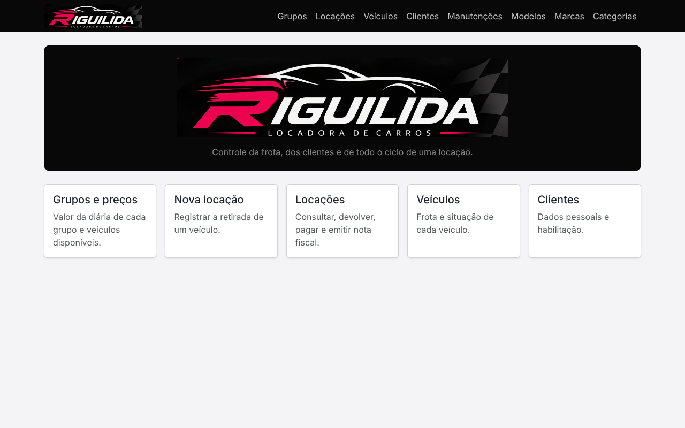

### Grupos e preços
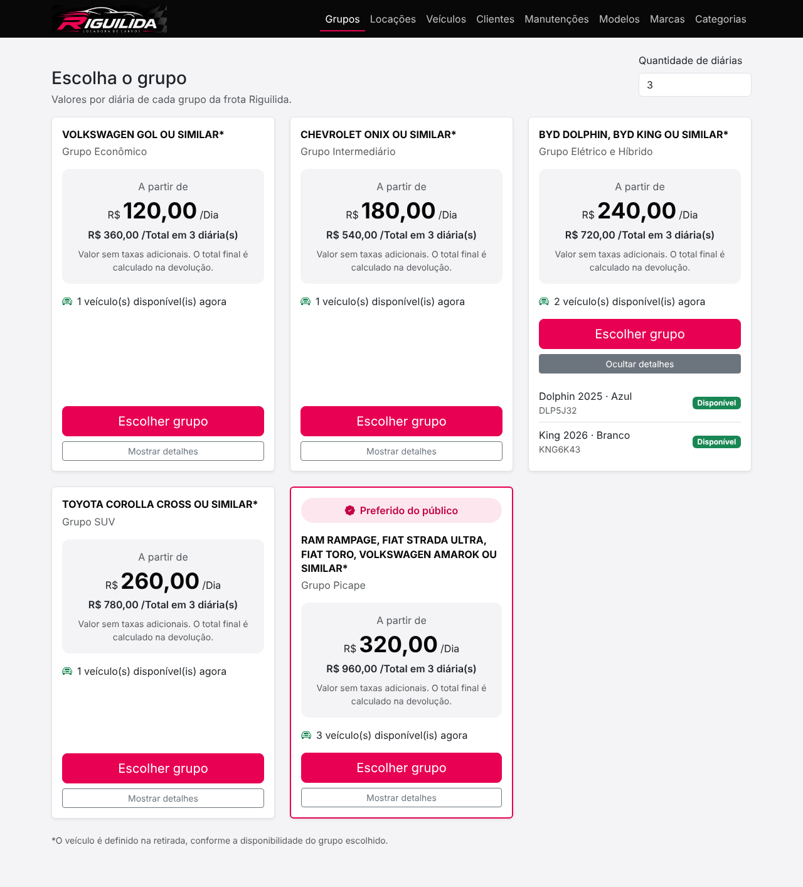

### Veículos e situação de cada um
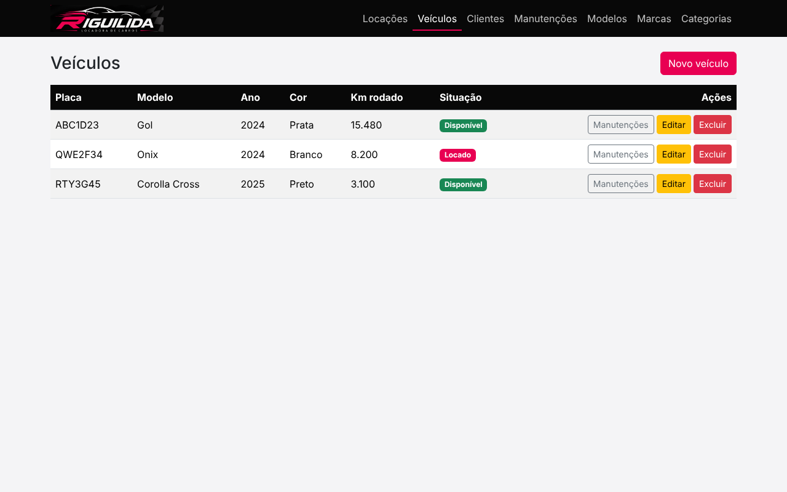

### Locações com filtros
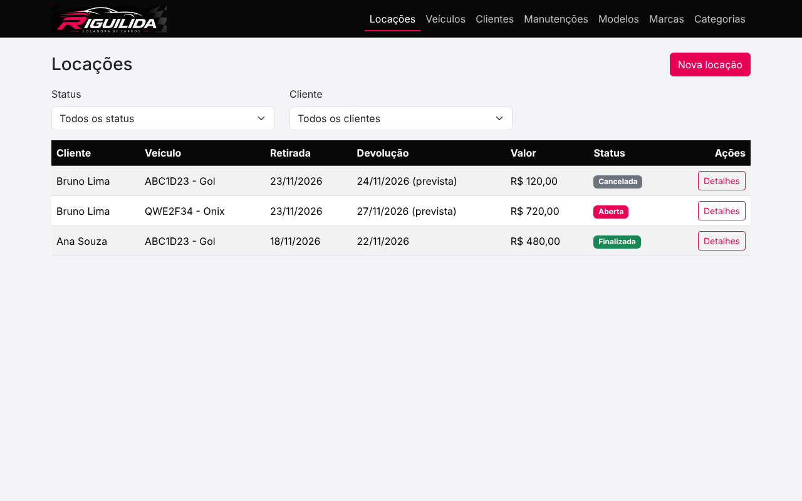

### Nova locação (com validação de CNH vencida)
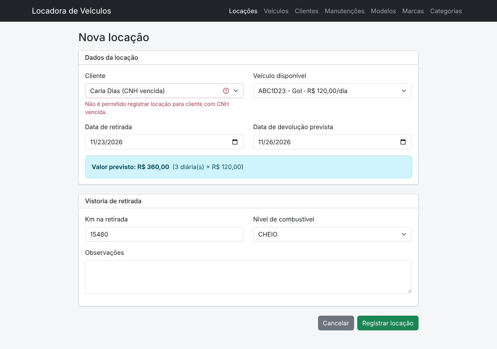

### Detalhes da locação
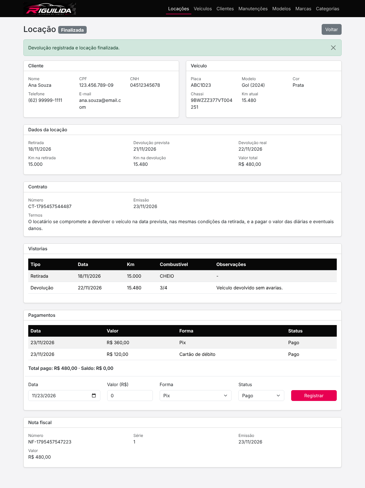

### Devolução
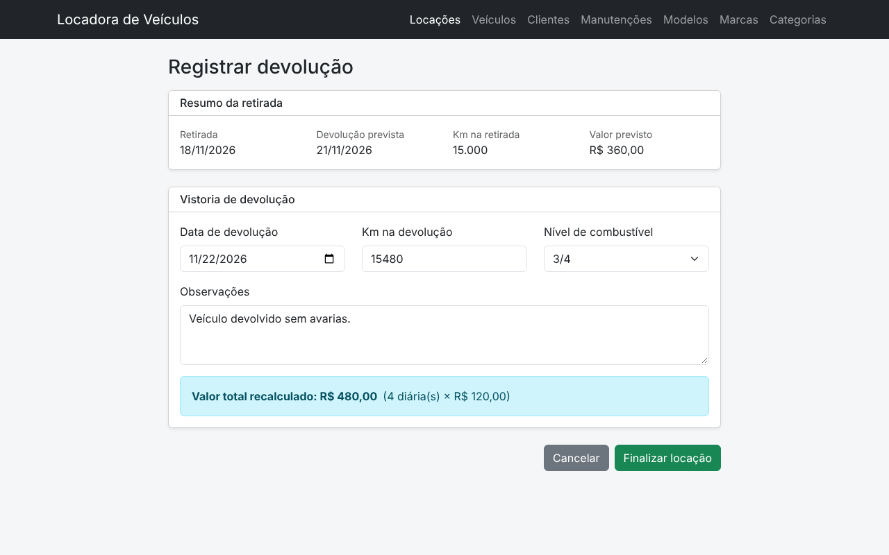

### Clientes
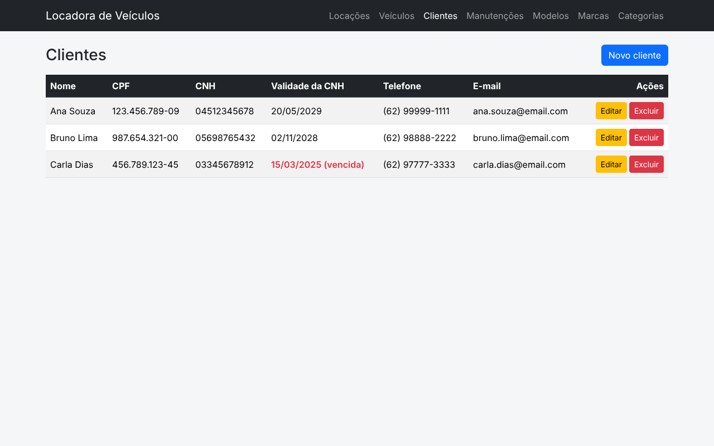

### Bloqueio de exclusão com dependentes
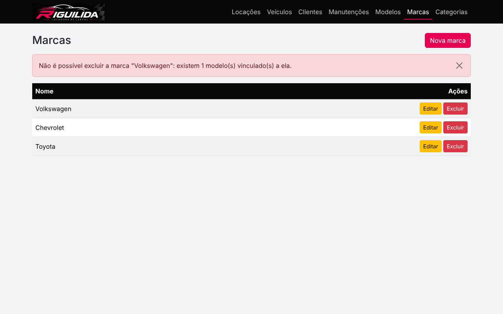

### Histórico de manutenções
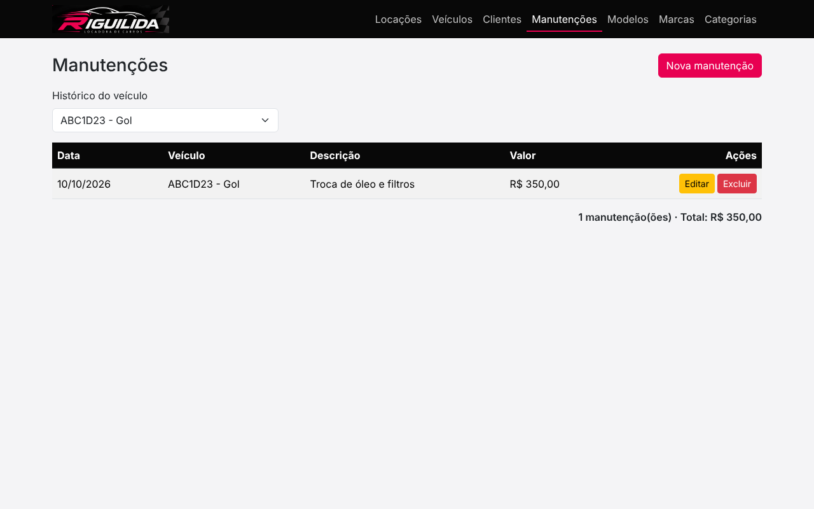

### Versão para celular
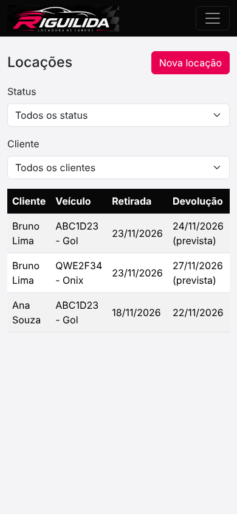
